<p align="center">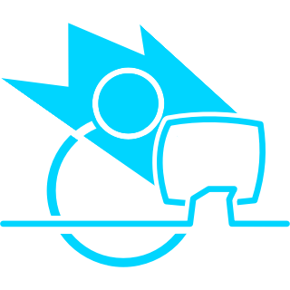</p>

# Operator Board

**Big, clear stage controls for Unreal Engine virtual production.**

[](https://github.com/JamesWardVP/Operator-Board/actions/workflows/build-windows.yml)
[](LICENSE)

**Version:** 0.2.3 · **Unreal Engine 5.2 – 5.8** · **Windows**

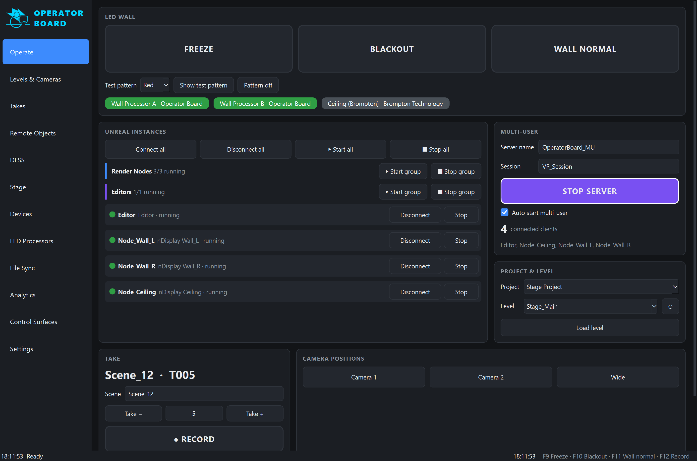

## Welcome

Running an LED volume means watching many things at once: the wall, the render nodes, the multi-user session, the level, the take. Unreal Engine's **Switchboard** can do all of it, but it was built for technicians setting a stage up, not for an operator running a shoot.

**Operator Board** puts everyday stage operations on one screen of large, readable buttons:

- **Freeze or black out the LED wall** in one press, straight on the LED processor.
- **Start and stop** the editor and every nDisplay node, one at a time or in groups.
- **Run the multi-user session** and see who is connected.
- **Change level**, toggle lighting sub-levels and **recall camera positions**.
- **Slate and record takes**, with a take log, timecode and genlock status.
- Drive it all from a **Stream Deck** or **Bitfocus Companion**.

It uses the same building blocks as Switchboard: **SwitchboardListener** on each machine and the **Remote Control API** inside Unreal. It even reads and writes **Switchboard's own config files**, so the two tools can share one stage setup. Switchboard does not need to be open.

## Getting started

1. **Download** `OperatorBoard-Setup-<version>.exe` from the [Releases](https://github.com/JamesWardVP/Operator-Board/releases) page and run it. Python does not need to be installed.
2. **Start Operator Board** from the Start menu.
3. **Make sure SwitchboardListener is running** on every machine that runs Unreal (`Engine\Binaries\Win64\SwitchboardListener.exe`), as you would for Switchboard. For UE 5.4 and later, Operator Board asks for each listener's password the first time it connects, just like Switchboard.
4. **Open your stage** on the **Stage** page: pick an existing Switchboard config, or create a new one.
5. **Add your LED processors** on the **LED Processors** page: choose the type and enter its IP address, as you would in Companion.
6. Go to **Operate**, connect, and you're running.

Want to try it without any hardware? Choose the **Simulator** LED processor type. Every wall command is logged instead of sent, which is handy for training.

## A tour of Operator Board

### Operate: the whole stage on one page
Freeze, blackout and test patterns for the wall; connect to, start and stop every Unreal instance (each machine has its own Connect / Disconnect button, and there is a Disconnect all), or a whole group; the multi-user server and its connected clients; project and level; the current take; and one-touch camera positions. The stage hotkeys work from any page: **F9** Freeze · **F10** Blackout · **F11** Wall normal · **F12** Record · **Ctrl+Shift+S** Start all.

If no LED processor is set up, or none can be reached, the LED Wall section is greyed out behind hazard tape with what to do (set up, retry, or use anyway); Operator Board checks processors when it starts and while any is offline. Blackout asks for confirmation by default, so the wall cannot be blacked out by accident (Settings > Confirm before blackout). When the wall is frozen, blacked out or showing a test pattern, a banner across the top makes that impossible to miss:

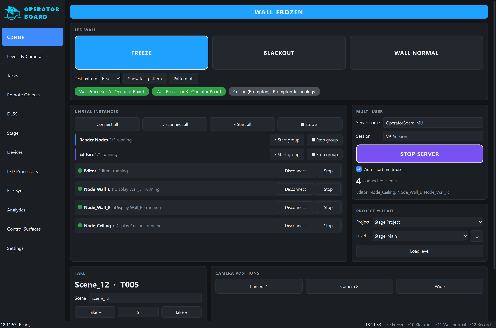

### Stage: share configs with Switchboard
Open, create and save **Switchboard config files**, the same files Switchboard lists. By default Operator Board looks in the folder Switchboard itself uses for the chosen engine (`Engine\Plugins\VirtualProduction\Switchboard\Source\Switchboard\configs`, or `SWITCHBOARD_CONFIG_DIR`), and you can pick any other folder.

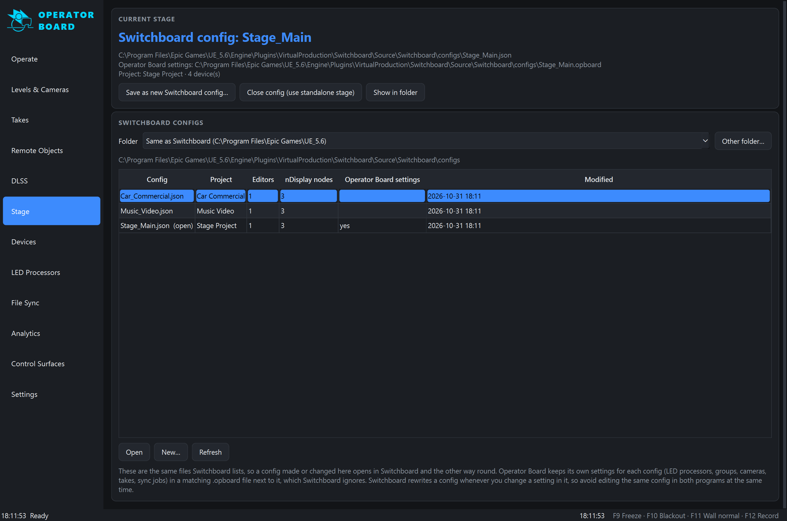

- A config made or changed here opens in Switchboard, and the other way round.
- Operator Board writes only the project, engine, editor and nDisplay devices, nDisplay config and multi-user settings. Every other Switchboard setting is kept exactly as it was.
- Operator Board's own settings for that stage (LED processors, groups, cameras, takes, sync jobs, Remote Control) go in a matching `<config>.opboard` file next to it, which Switchboard ignores.
- Switchboard rewrites a config whenever you change a setting in it, so avoid editing the same config in both programs at the same time.

### LED Processors: Companion-style setup
Choose the processor type, enter its IP address and port, and the wall buttons drive every processor at once.

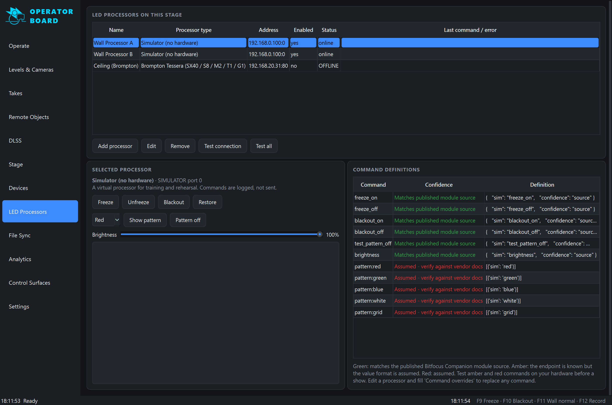

| Processor | Connection | Freeze | Blackout | Test patterns | Brightness |
|---|---|---|---|---|---|
| Brompton Tessera (SX40 / S8 / M2 / T1 / G1) | HTTP :80 | ✅ | ✅ | ✅ | ✅ |
| Megapixel HELIOS | HTTP :80 (REST) | ✅ | ✅ | ✅ | ✅ |
| NovaStar MCTRL (300 / 600 / 660 / 4K / R5) | TCP :5200 | ✅ | ✅ | ✅ | ✅ |
| NovaStar VX / NovaPro | TCP :5200 | ✅ | ✅ | – | ✅ |
| Generic HTTP / TCP / UDP / OSC | user defined | ✅ | ✅ | ✅ | ✅ |
| Simulator (no hardware, for training) | – | ✅ | ✅ | ✅ | ✅ |

Every command shows how it was verified. Some come straight from the published Companion module sources; others should be checked against your processor's firmware before a show (see [docs/LED_PROCESSORS.md](docs/LED_PROCESSORS.md)). You can override any command per processor, and add new processor types as JSON profiles without changing any code.

### Devices: Unreal instances and groups
Editors and nDisplay nodes are started through SwitchboardListener (port 2980) with the same command-line flags as Switchboard. Operator Board connects the way each engine's Switchboard does: an encrypted QUIC connection with the listener's password for UE 5.4 – 5.8, and plain TCP for 5.2 – 5.3, chosen automatically (or set per device). Listener passwords are saved in Windows Credential Manager and shared with Switchboard, so a machine you have already connected to from Switchboard needs no password, and if a listener's security key changes you are warned before connecting. Put them in groups that start and stop together, and check each device's log for its launch command line and process events. You can also import devices from any Switchboard config.

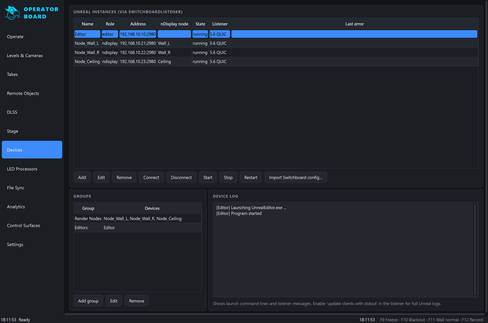

### Multi-user
Start and stop the multi-user (Concert) server on this machine or on any listener machine, as a console or Slate server. Name the server and session; editors and nodes join automatically. With **Auto start multi-user** (on by default) the server is started first whenever an editor or node that joins multi-user is launched. Sessions are numbered: every time the server is stopped the session name moves on (VP_Session, VP_Session_2, VP_Session_3…), and if the server starts with a session of that name still on it (a server stopped by force keeps its sessions), Operator Board moves to the next free name and warns clearly that this is a new session, not the previous one. Turn off **Number sessions** in Settings > Multi-user server to keep one name. If the server refuses clients because its session belongs to another project, Operator Board says so and how to fix it. The connected-client count and names come from the server log, and the log patterns can be changed.

### Levels & Cameras
Manage several projects and switch between them, or find `.uproject` files on disk. Levels are listed from the project's Content folder or from the editor through Remote Control. Load a level in the editor, change level on the nodes at runtime, or relaunch the nDisplay nodes on the new level. Show or hide **streaming sub-levels** (for example, lighting setups) and toggle **World Partition data layers**. **Camera positions** capture and recall the editor viewport or any camera or nDisplay root actor.

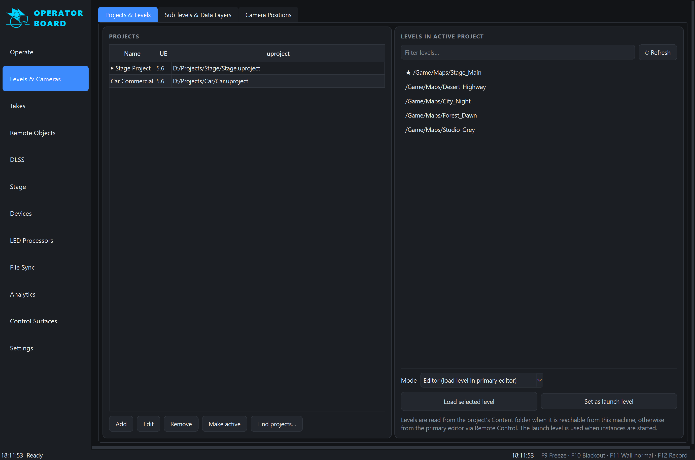

### Takes
Scene (slate) name, take number and description with auto-increment. Type a new scene name or jump straight to any take number on the Operate page (or use Take − / Take +); changes show straight away in the editor's Take Recorder panel. Recording drives **Take Recorder** in the primary editor, which records the **sources** set in its panel (cameras, actors and so on). Save them as a Take Preset and enter its path in Settings > Takes, and every recording uses it. If the take is empty, Operator Board adds the stage camera and records: the nDisplay setup's ICVFX camera, otherwise the cine camera in the level (or the actor named in Settings > Takes > Take camera), and says which one it added. Pressing Record plays Take Recorder's own countdown (its Countdown setting) on the Record button, and the button only switches to recording once Unreal really is recording; pressing it during the countdown cancels the take. **Save take** (Operate and Takes pages) saves a recorded take in the editor; in a multi-user session it also writes the take into the project on the editor's PC (persists it) without sending anything more to the other machines or the LED wall. While a multi-user session is running it also warns when the take's files would pass the 259-character Windows path limit (long paths off), which Unreal reports as "Unable to open a file for writing". The Take card shows the primary editor's **timecode** and the stage's **genlock** (from each machine's NVIDIA sync board through its listener, as in Switchboard, or else the editor's custom time step); either reads **No data** when there is nothing to show. Every take goes into a persistent log with Good, Circle and NG ratings and notes; the log exports to CSV.

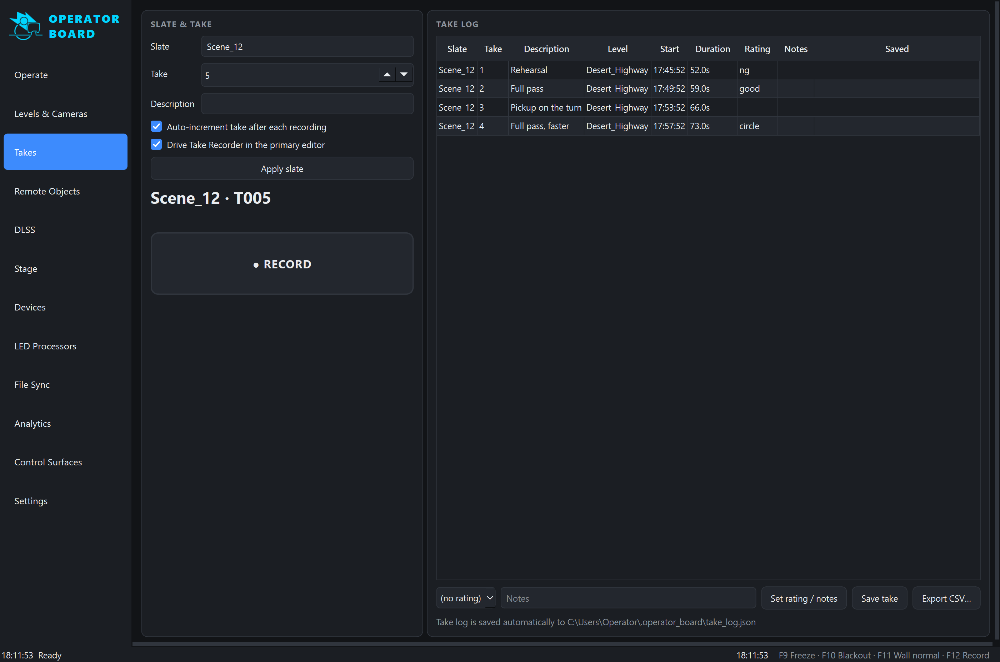

### Analytics
Live CPU, GPU, GPU clock, GPU temperature and memory for every running instance, plus the running-instance and multi-user client counts. Graphs cover 1 minute to 1 hour, next to a raw sample table, the last raw listener payload and CSV export.

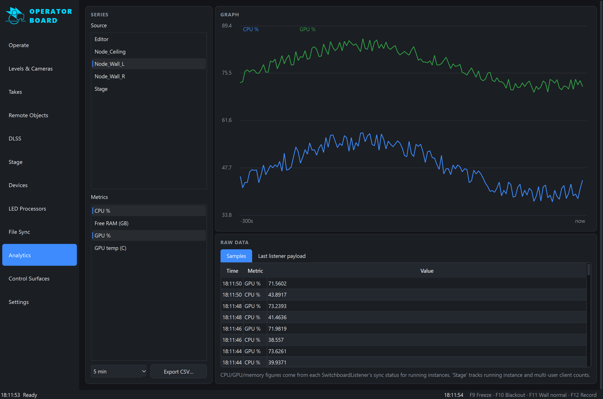

### Control Surfaces: Stream Deck and Companion
Drive an **Elgato Stream Deck** directly (Mini, 15-key / MK.2, XL, +, Neo), with several pages and live key colours. A default layout is included; edit it on the on-screen deck, and **save it to or load it from a file** to take it to another machine. **Bitfocus Companion** (Generic HTTP module), or anything else that can send HTTP, can call any action through the local HTTP API, with an optional token.

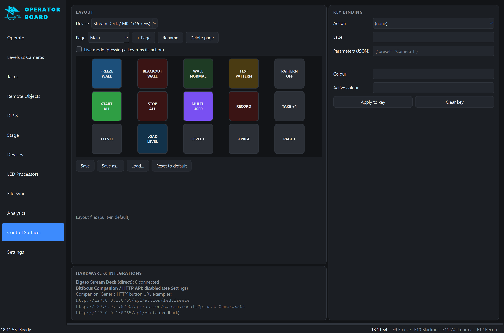

On Windows, quit the Elgato Stream Deck app first, because only one program can own the device.

### Remote Objects and DLSS
- **Remote Objects:** browse **Remote Control Presets**, read and set exposed properties and call exposed functions on the editor, the nodes or everything. An actor browser lists actors and lets you inspect and change their properties.
- **DLSS:** DLSS Super Resolution mode, Frame Generation, Ray Reconstruction, Reflex and Screen Percentage, applied to the editor, the nodes or all instances, with plugin detection. The controls are defined in `dlss.json`, so a change in the plugin's API only needs a JSON edit.

### File Sync
Run sync jobs with **FreeFileSync** batch jobs, **Perforce**, **Git**, **Robocopy** or a custom command, on this machine or on the render nodes through their listeners, with a history of results and output.

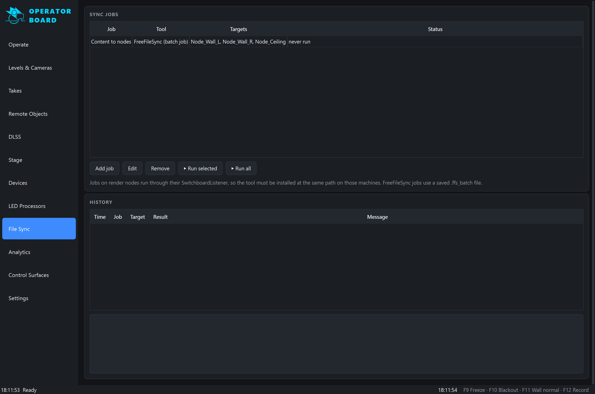

## Supported Unreal Engine versions

| Unreal Engine | Supported |
|---|---|
| 5.2 | ✅ |
| 5.3 | ✅ |
| 5.4 | ✅ |
| 5.5 | ✅ |
| 5.6 | ✅ |
| 5.7 | ✅ |
| 5.8 | ✅ |

Operator Board detects the engine version from `Engine/Build/Build.version` when you choose an engine folder.

## What Unreal needs

| Feature | Needs |
|---|---|
| Start / stop instances, sync on nodes, analytics | SwitchboardListener running on each machine (port 2980: UDP for UE 5.4+, TCP for 5.2 – 5.3), with a password set in its window for UE 5.4+ |
| Levels, sub-levels, cameras, takes, objects, DLSS | **Remote Control API** plugin (instances are launched with `-RCWebControlEnable`). Unreal's Remote Control blocks remote Python, console commands and (5.8) most function calls by default; Operator Board allows them on the editors and nodes **it starts** (Settings > Remote Control). For an editor started another way, enable them in Project Settings > Plugins > Remote Control > Security. |
| Level loading, sub-levels, data layers, viewport cameras, Take Recorder | **Python Editor Script Plugin** in the editor |
| DLSS page | NVIDIA DLSS / Streamline plugins |

## Installation

### Windows installer (recommended)

Download **`OperatorBoard-Setup-<version>.exe`** from the [Releases](https://github.com/JamesWardVP/Operator-Board/releases) page and run it. Python is not needed.

- It installs for your Windows account without needing administrator rights (administrators can choose to install for all users), adds Operator Board to the Start menu (and, if you tick it, the desktop), and offers to start it straight away.
- Windows may show **"Windows protected your PC"** once, for the setup file only, because it is not code-signed yet: click **More info → Run anyway**. Operator Board itself then starts without warnings.
- To update, run the newer setup file. It closes Operator Board if it is open and keeps your settings.

### Portable zip

Download `OperatorBoard-<version>-win64.zip` instead if you'd rather not install anything. Before unzipping, right-click the zip → **Properties** → tick **Unblock** → **OK** (this avoids the Windows warning), then unzip it anywhere and run **`OperatorBoard.exe`**.

### Both

- `OperatorBoardConsole.exe` is the same program with a console window, for `--headless` on a rack PC or for troubleshooting.
- Settings live in `%USERPROFILE%\.operator_board\`, with a log in its `logs` folder.

### From source

Requires Python 3.9 or newer.

```bash
git clone https://github.com/JamesWardVP/Operator-Board.git
cd Operator-Board
pip install -r requirements.txt
python -m operator_board
```

For direct Stream Deck support, also run `pip install streamdeck pillow`.

**Running with Switchboard's own Python:** `scripts\run_with_switchboard_python.bat "C:\Program Files\Epic Games\UE_5.6"` uses the Python environment that ships with Switchboard, so nothing extra is installed. PySide2 (UE 5.2/5.3) and PySide6 are both supported.

### Command line

| Option | What it does |
|---|---|
| `--switchboard-config PATH` | Open this Switchboard config (`.json`) as the stage. |
| `--headless` | No window: only the HTTP API and Stream Deck, for a stage rack PC. |
| `--no-hardware` | Do not open Stream Deck hardware. |
| `--config PATH` | Use another Operator Board settings file. |
| `--verbose` | More detailed logging. |

### Uninstalling

1. **Installed:** remove **Operator Board** in Windows **Settings → Apps → Installed apps**. **Portable:** close Operator Board and delete the folder you unzipped.
2. Settings are kept so a reinstall picks them up. To remove them and the logs too, delete `%USERPROFILE%\.operator_board\`.
3. If you used Switchboard configs, the matching `.opboard` files next to them can be deleted. Switchboard does not use them.

## Development

```bash
pip install -e .[ui,dev]
python -m pytest
```

Build the Windows executables: `dist/OperatorBoard/`, a zip and the setup file. The setup file is built whenever [Inno Setup 6](https://jrsoftware.org/isinfo.php) is installed (`winget install JRSoftware.InnoSetup`). Close Operator Board first if it is running from `dist/`.

```bash
pip install -e .[ui,build,streamdeck]
python packaging/build.py --hidapi
```

To release, set the new version everywhere with `python packaging/bump_version.py X.Y.Z`, merge `Development` into `main`, and push a `vX.Y.Z` tag. The release build checks that the tag matches the version.

GitHub Actions runs the tests and this build on every push, and attaches the installer and the zip to a GitHub Release when a `v*` tag is pushed. The test suite includes fake SwitchboardListener and HTTP peers and an offscreen UI smoke test. The screenshots above are made with `python docs/make_screenshots.py`. The project layout is described in [docs/ARCHITECTURE.md](docs/ARCHITECTURE.md).

Work happens on the `Development` branch and reaches `main` through pull requests.

## Code signing policy

Free code signing provided by [SignPath.io](https://about.signpath.io), certificate by [SignPath Foundation](https://signpath.org).

Signed Windows releases start once SignPath Foundation has approved the project; until then, releases are unsigned. Only `OperatorBoard.exe` and `OperatorBoardConsole.exe` built by this repository's GitHub Actions workflow from its own source code are signed.

**Team roles**

- Committers and reviewers: [JamesWardVP](https://github.com/JamesWardVP)
- Approvers: [JamesWardVP](https://github.com/JamesWardVP)

Every change from anyone outside the team is reviewed before it is merged, and every signing request is approved by an approver.

## Privacy policy

This program will not transfer any information to other networked systems unless specifically requested by the user or the person installing or operating it.

Listener passwords you enter are kept in Windows Credential Manager on this computer, in the same entries Switchboard uses, and are only sent to that listener. Operator Board only connects to the machines and devices you configure: SwitchboardListener and Unreal's Remote Control API on your stage machines, your LED processors, and the sync tools you set up. Its HTTP API listens on this computer only (`127.0.0.1`) unless you change that in Settings. It has no telemetry, analytics reporting or update checks.

## License

Operator Board is released under the [MIT License](LICENSE). The Windows release includes open-source components under their own licenses, listed in [THIRD_PARTY_NOTICES.md](THIRD_PARTY_NOTICES.md).

Unreal Engine, Switchboard and SwitchboardListener are products of Epic Games, Inc. Operator Board is an independent project and is not affiliated with or endorsed by Epic Games, Brompton Technology, Megapixel VR, NovaStar, Elgato or Bitfocus.
